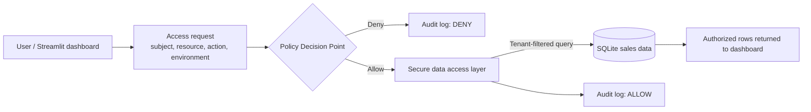

# Secure Data Access Layer with ABAC

A Python demonstration of Attribute-Based Access Control (ABAC) for tenant-aware access to sales data. A request is evaluated using the requesting user's attributes, the requested resource, the action, and the request environment. Access decisions are enforced before data is returned and recorded in an audit log.

## Project components

- `src/secure_data_access_layer/models.py` defines the subject, resource, action, environment, and access-request models.
- `src/secure_data_access_layer/policy.py` contains the Policy Decision Point (PDP), which applies the access rules.
- `src/secure_data_access_layer/data_access.py` initializes the sample SQLite database and enforces authorization and tenant filtering before returning sales rows.
- `src/secure_data_access_layer/audit.py` writes JSON-formatted access decisions to the audit log.
- `src/secure_data_access_layer/app.py` provides a Streamlit dashboard for submitting access requests and viewing recent audit events.
- `data/` stores the local SQLite database; `logs/` stores the local audit log.

## Architecture



The dashboard submits an access request to the secure data layer. The policy decision point evaluates it before the SQLite query runs. Denied requests return no rows; allowed queries are additionally filtered to the subject's tenant.

## Policy rules

1. The subject and resource must belong to the same tenant.
2. The subject's clearance must meet or exceed the resource's classification.
3. Confidential and restricted resources require verified MFA.
4. Analysts may read; engineers may read and write; admins may read, write, and delete according to the PDP role map.
5. The current data access service exposes sales reads only. Write and delete actions are not implemented by this demonstration service.
6. Requests that fail a policy check are denied. The data query also filters by the requesting subject's tenant.

## Setup on Windows (PowerShell)

Open PowerShell in this project folder and run:

```powershell
py -m venv .venv
.\.venv\Scripts\Activate.ps1
python -m pip install -r requirements.txt
$env:PYTHONPATH = (Join-Path (Get-Location) "src")
python -m streamlit run src/secure_data_access_layer/app.py
```

If PowerShell blocks environment activation, allow it for the current terminal only, then activate again:

```powershell
Set-ExecutionPolicy -Scope Process -ExecutionPolicy Bypass
.\.venv\Scripts\Activate.ps1
```

Open the local address printed by Streamlit, usually `http://localhost:8501`. Stop the app with Ctrl+C in the terminal.

## Dashboard demonstration

- **Allowed request:** analyst, user's tenant `tenant-a`, data tenant `tenant-a`, action Read, and clearance at least as high as the data classification. For Confidential or Restricted data, keep MFA verified.
- **Cross-tenant denial:** set the user's tenant and data tenant to different tenants.
- **Insufficient-clearance denial:** choose a lower user clearance than the data classification.
- **MFA denial:** choose Confidential or Restricted data and uncheck MFA verified.

The dashboard shows returned rows only for allowed read requests. It displays a denial reason when a request is rejected.

## Manual validation results

| Scenario | Expected | Observed |
|---|---|---|
| Analyst reads same-tenant data | Allow | Allow; tenant-a rows displayed |
| Analyst requests a different tenant's data | Deny | Denied with tenant-mismatch `PermissionError`; no rows returned |
| Restricted-clearance user requests Confidential data without MFA | Deny | Denied because MFA is required |
| Engineer reads same-tenant Internal data | Allow | Allow |
| Admin reads same-tenant Confidential data with MFA | Allow | Allow |

The dashboard's recent audit events showed both `ALLOW` and `DENY` entries during these demonstrations.

## Audit log

Access decisions are appended as JSON lines to `logs/access.log`. The dashboard displays recent entries, including timestamp, user, subject and resource tenants, action, decision, and reason. Local database and log files are excluded from version control.

## Dependency

The initial dependency is listed in `requirements.txt`. SQLite is provided by Python's standard library.
